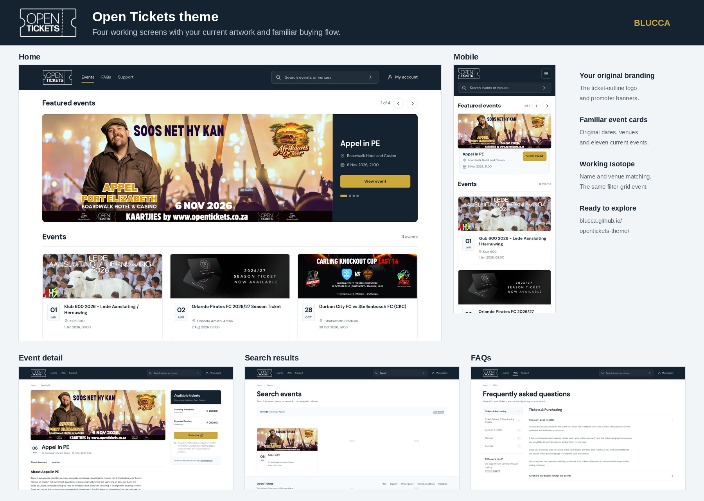

# Open Tickets theme

Four working Bootstrap 5 screens for Open Tickets, built around the current ticket-outline logo, promoter artwork and familiar buying flow.

**[Open the theme](https://blucca.github.io/opentickets-theme/)** · [Event detail](https://blucca.github.io/opentickets-theme/event.html) · [FAQs](https://blucca.github.io/opentickets-theme/faqs.html) · [Search example](https://blucca.github.io/opentickets-theme/search.html?q=Appel)



## Included

- Home: all four original featured banners, manual carousel, eleven current event cards in their original order, fixed navigation that shrinks on scroll.
- Event detail: original Appel artwork, description, entry rules, venue and both published R250 ticket categories.
- FAQs: all nineteen original answers, grouped into the five existing categories.
- Search: the same name/venue matching, backed by real Isotope 3.0.6.
- Responsive HTML, local Bootstrap 5.3.8, local DM Sans, SVG icons and original images. All theme tokens are at the top of `assets/css/theme.css`.

Artwork keeps its original proportions and text. The home hero pairs each promoter's banner with a dark ticket-stub panel for the date, venue and action. The original white ticket-outline logo sits on a dark navigation bar; the quiet white layouts let the event artwork do the talking.

## Open locally

```sh
python -m http.server 8000
```

Visit `http://localhost:8000/`. Everything needed for the four screens is local.

## Integrate with the existing site

The home and search grid retain these hooks:

```text
#nav-search-input
#events-grid
.grid-item[data-name][data-venue]
window event: filter-grid, detail: query string
Isotope: itemSelector .grid-item, layoutMode fitRows
```

Matching uses the existing lowercase name/venue attributes. Queries shorter than three characters show all cards; typing three characters or clearing the input dispatches the same event. Enter opens the search screen with `q`.

The preview uses `index.html`, `event.html`, `faqs.html`, and `search.html?q=…`. In the server templates, map these to the existing `/`, `/event/{id}`, `/faq`, and `/search?q=…` routes and render the existing event data into the same markup. Keep the site's current queue, cart and booking handlers. The preview's booking link hands off to the live Open Tickets event.

Theme variables cover paper, ink, slate, accent, borders, font and content width. Component classes are in `theme.css`; the small `theme.js` handles the header, carousel, FAQ categories and original filter contract.

## Small acceptance check

With Chromium and Python Playwright installed:

```sh
python check.py
```

This checks the four pages, Isotope name/venue/short-query/empty matching, native search submission, carousel, FAQ categories, original prices and booking destination, and desktop/mobile layout. No payment is initiated.

## Sources

Content snapshot: the public Open Tickets site, 29 October 2026. Original branding and promoter artwork are included for the requested theme evaluation. Source URLs are recorded in `assets/assets-source.json`.

Bootstrap is MIT licensed. DM Sans is SIL Open Font licensed (`assets/fonts/OFL.txt`). Isotope retains its official GPLv3/commercial dual-license notice. BLUCCA's original theme code is available to the commissioning client for integration.
